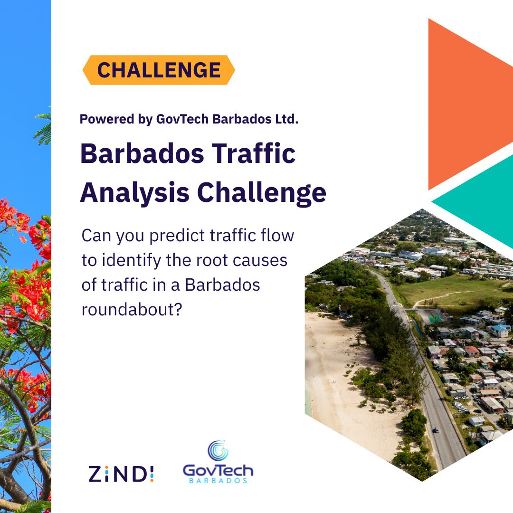
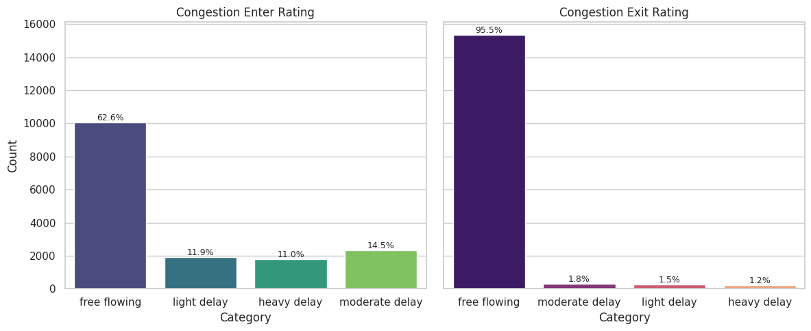
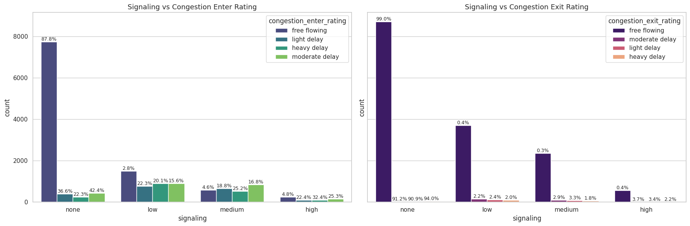
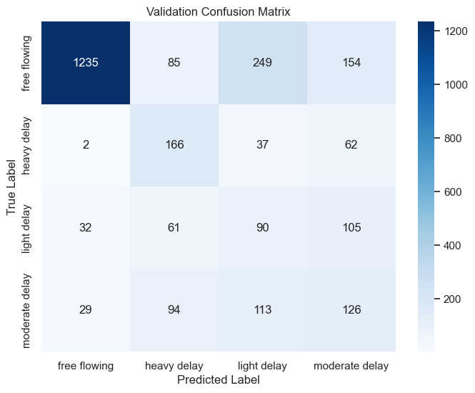

<h1 align="center">Barbados Traffic Analysis Challenge</h1>

Our code for the [Barbados Traffic Analysis Challenge](https://zindi.africa/competitions/barbados-traffic-analysis-challenge), a Zindi competition run with GovTech Barbados from November 2025 to January 2026. Four cameras film the Norman Niles roundabout, and the goal is to predict how congested its entrances will be five minutes later. Our team, Tourists, finished **13th on the private leaderboard** with a score of 0.7073.

<p align="center">
  
</p>

## The task

Each camera watches one entrance and exit of the roundabout. The videos are cut into clips of about one minute, and each clip has a congestion rating for its entrance and its exit: `free flowing`, `light delay`, `moderate delay` or `heavy delay`.

At test time a model gets 15 minutes of video from all four cameras, then a 2-minute embargo, and must predict the next five minutes one minute at a time. It cannot use anything recorded after the minute it is predicting, so it has to work like a real-time system.

The score is `0.7 × Macro-F1 + 0.3 × Accuracy` over the four classes.

<p align="center">
  
</p>

<div align="center">

https://github.com/user-attachments/assets/5c04d5a6-1a06-403b-a785-2e3376761a24

<em>A training clip labelled heavy delay.</em>

</div>

## The data

- 18,716 clips: 131 GB in the compressed version, 581 GB uncompressed.
- Recorded between 06:00 and 18:00 over seven days, 20 to 26 October 2025.
- 16,076 labelled training clips and 2,640 test input clips, split evenly across the four cameras.
- Each clip also has a turn-signal level: `none`, `low`, `medium` or `high`.

The labels are very unbalanced. About 63% of entrance ratings are `free flowing`, and 95.5% of exit ratings are.

<p align="center">
  
</p>

Turn signals turned out to be a strong hint. Clips with no signalling are mostly free flowing, while most delayed clips fall in the low, medium and high signalling groups.

<p align="center">
  
</p>

Other checks from the notebook:

- The four cameras give the same entrance rating for a given minute in 2,310 of 4,019 time segments (57%).
- Entrance and exit ratings match in 64% of clips.
- A camera's rating matches its rating from the previous minute 61 to 65% of the time.

## Approach

### Features from each clip

Each extractor in [`src/feature_extraction.py`](src/feature_extraction.py) turns a clip into one row of numbers and caches the result as a CSV, so adding a feature type never means recomputing the others.

| Extractor | What it measures |
|---|---|
| `SimpleExtractor` | Brightness, colour, saturation, edges, blur, entropy and frame-difference motion on small grayscale frames |
| `FlowExtractor` | Farneback optical flow statistics, decoded with PyAV at reduced resolution |
| `YOLOExtractor` | YOLO11n detections: vehicle counts by type (car, bus, truck, motorcycle), box sizes, how the count changes over the clip |
| `YOLOFlowExtractor` | YOLO11n-seg tracking: speeds, stopped vehicles, traffic per zone of the frame |
| `EmbeddingExtractor` | EfficientNet-B0 frame embeddings, as mean and spread over the clip |
| `VideoMAEExtractor` | VideoMAE-base clip embeddings |
| `PerceptionEncoderExtractor` | Meta Perception Encoder (PE-Core-L14-336) clip embeddings; the notebook uses 14 PCA components of them |

### Time features

Hour, minute and day of week, their sine and cosine encodings, morning and evening peak flags, and the turn-signal level.

### Models

Random Forest, XGBoost (with the competition metric as its eval metric), LightGBM, CatBoost and a soft-voting ensemble, tuned with Optuna ([`src/optimize.py`](src/optimize.py)). We also fine-tuned VideoMAE end to end on the raw clips ([`src/video_models.py`](src/video_models.py)).

### Validation

The labelled 15-minute test input segments are the hold-out set. Cross-validation is a 5-fold `StratifiedGroupKFold` grouped by time segment, so the four views of the same minute never land on both sides of a split. The final code trains on entrance ratings only, since a challenge update dropped exit ratings from the score.

## Results

Scores on the hold-out set, as printed in our notebooks:

| Pipeline | Features | Model | Macro-F1 | Accuracy | Score |
|---|---|---|---|---|---|
| Early (entrance and exit) | simple + YOLO + Perception Encoder | XGBoost | 0.3636 | 0.5687 | 0.4251 |
| Early (entrance and exit) | simple + YOLO + Perception Encoder | CatBoost | 0.3683 | 0.5752 | 0.4304 |
| Early (entrance and exit) | simple + YOLO + Perception Encoder | LightGBM | 0.3482 | 0.7661 | 0.4736 |
| Final (entrance only, grouped CV) | YOLO + time | CatBoost | 0.4635 | 0.6125 | 0.5082 |

The final CatBoost run had a mean cross-validation score of 0.5108 (± 0.0129). It rarely calls a delayed clip free flowing (63 of 917), but it often confuses the three delay levels with each other, and it labels 249 free-flowing clips as light delay.

<p align="center">
  
</p>

On Zindi our best submission scored 0.5966 on the public leaderboard and 0.7073 on the private one (Macro-F1 0.7134, accuracy 0.6932), which placed us 13th after 30 submissions.

<p align="center">
  
</p>

## How to run

We developed the code on Kaggle with a GPU, and the paths in [`src/config.py`](src/config.py) point to the Kaggle copies of the competition data.

```bash
git clone https://github.com/anyantudre/zindi-barbados-traffic-analysis.git
cd zindi-barbados-traffic-analysis
pip install -r requirements.txt
```

1. Get the data from the [competition data page](https://zindi.africa/competitions/barbados-traffic-analysis-challenge/data) or with `DataLoader.download_datasets()`, which pulls the Kaggle mirrors through `kagglehub`. Put `Train.csv`, `TestInputSegments.csv` and `SampleSubmission.csv` in `data/`, and change the video folders in `Config` if you are not on Kaggle.
2. Open [`notebook-barbados-challenge.ipynb`](notebook-barbados-challenge.ipynb). On the first run, set the `EXTRACT_*` flags you want to `True`. This computes the features and saves them as CSV files.
3. Set the flags back to `False`, point the matching `*_FEATURES_PATH` settings at the CSV files, and train:

```python
from src.config import Config
from src.pipeline import TrainingPipeline, InferencePipeline

config = Config()
config.SIMPLE_FEATURES_PATH = None
config.YOLO_FEATURES_PATH = "data/yolo_features.csv"

pipeline = TrainingPipeline(config)
pipeline.run(model_name="catboost", use_cv=True, n_splits=5)  # or "random_forest", "xgb", "lgbm", "ensemble_soft"

inference = InferencePipeline(config, model=pipeline.model)
inference.prepare_test_data(pipeline.testing_df)
inference.predict_and_save("submission.csv")
```

The notebook here is the Kaggle version. Its printed outputs come from the early pipeline in the results table.

## Repository layout

```
├── src/
│   ├── config.py              # paths, feature lists, settings
│   ├── data_loader.py         # dataset download and loading
│   ├── feature_extraction.py  # the seven video feature extractors
│   ├── preprocessing.py       # time features, merging, train/validation/test split
│   ├── model_dispatcher.py    # model definitions and the competition metric
│   ├── model.py               # training with cross-validation, prediction
│   ├── optimize.py            # Optuna hyperparameter search
│   ├── pipeline.py            # training and inference pipelines
│   ├── video_models.py        # VideoMAE fine-tuning
│   ├── visualization.py       # plots
│   └── utils.py
├── img/                       # figures used in this README
├── notebook-barbados-challenge.ipynb
└── requirements.txt
```

## Team

- [Wendemi Brice Roméo ZEMBA](https://github.com/BriceZemba)
- [Wendyellé A. Alban NYANTUDRE](https://github.com/anyantudre)

Thanks to the Ministry of Transport and Works of Barbados, GovTech Barbados and Zindi for the data and the competition.

## License

[MIT](LICENSE)
