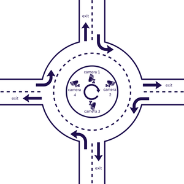
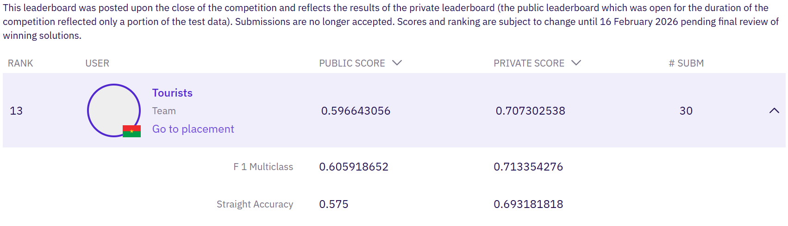

# Barbados Traffic Analysis Challenge

Machine Learning (ML) solution for predicting traffic congestion in roundabouts using video data analysis, developed for the [Zindi Barbados Traffic Analysis Challenge](https://zindi.africa/competitions/barbados-traffic-analysis-challenge).


## Challenge Objective
*The Ministry of Transport and Works* in Barbados seeks to identify root causes of traffic congestion in roundabouts using ML. The task involves predicting traffic congestion levels 15 minutes into the future based on video data from four cameras monitoring the Norman Niles roundabout.


**Key Constraints:**
- Predict congestion 15 minutes ahead using 45 minutes of historical video data
- 2-minute embargo period (simulating real-time processing delay)
- No back-propagation allowed during training or inference
- Must predict both entrance and exit congestion ratings

**Congestion Classes:**
- `free flowing`
- `light delay`
- `moderate delay`
- `heavy delay`


### Evaluation
The challenge uses a multi-metric evaluation system:

- **Macro-F1 (70%)**: Measures balanced performance across all four congestion classes
- **Accuracy (30%)**: Measures overall percentage of correct predictions

**Final Score:** `0.7 × Macro-F1 + 0.3 × Accuracy`


### About the Data
The dataset consists of video streams from four cameras positioned at different entrances and exits of the Norman Niles roundabout. Each video segment (~1 minute) is labeled with congestion ratings for both entrance and exit timestamps.



**Data Structure:**
- Training data: Videos with labeled congestion ratings
- Test data: Videos without labels (45 minutes input + 2-minute embargo + 15-minute prediction window)
- Four camera views: Unique perspectives of roundabout entrances/exits
- Temporal alignment: All four cameras record the same time periods


## Our Approach

### Feature Extraction Strategies
We implemented a modular feature extraction pipeline with multiple extractors:

#### 1. **Basic Features**
- **Simple Features** (`SimpleExtractor`): Lightweight statistical features (intensity motion, edge activity, brightness, color dominance, scene occupancy)
- **Optical Flow** (`FlowExtractor`): Farneback optical flow for motion pattern analysis and vehicle movement dynamics

#### 2. **YOLO-based Detection & Tracking**
- **Vehicle Detection** (`YOLOExtractor`): YOLOv11-based vehicle detection, counting, and type classification (car, truck, bus, motorcycle) with bounding box statistics
- **Vehicle Tracking** (`YOLOFlowExtractor`): YOLOv11 tracking with persistence, speed estimation, stopped vehicle detection, and zone-based traffic distribution

#### 3. **Deep Learning Embeddings**
- **Scene Embeddings** (`EmbeddingExtractor`): EfficientNet-B0 pre-trained embeddings with batch inference
- **VideoMAE Embeddings** (`VideoMAEExtractor`): Spatio-temporal video transformer embeddings using pre-trained VideoMAE-base model
- **Perception Encoder** (`PerceptionEncoderExtractor`): Meta's Perception Encoder (PE) for video understanding and spatio-temporal feature extraction


### Modeling Strategies

#### 1. **Tree-Based Models**
- **Random Forest**: Baseline model with class balancing
- **XGBoost**: Gradient boosting with custom competition metric
- **LightGBM**: Fast gradient boosting with GPU support
- **CatBoost**: Categorical boosting with balanced class weights

#### 2. **Ensemble Methods**
- **Voting Classifier**: Soft voting ensemble combining multiple tree-based models
- Cross-validation for robust performance estimation

#### 3. **Video Transformer Models**
- **VideoMAE**: Fine-tuned VideoMAE transformer for direct video classification
- End-to-end training with Hugging Face Transformers
- Competition metric optimization during training


### Project Structure
```
├── src/
│   ├── config.py              # Configuration and parameters
│   ├── data_loader.py         # Data loading utilities
│   ├── feature_extraction.py  # Video feature extraction
│   ├── preprocessing.py       # Data preprocessing
│   ├── visualization.py       # Plotting functions
│   ├── model.py               # Model class
│   ├── model_dispatcher.py    # Model factory and definitions
│   ├── optimize.py            # Hyperparameter optimization
│   ├── pipeline.py            # Training & inference pipelines
│   ├── utils.py               # Utility functions
│   └── video_models.py        # Video transformer models
├── notebook-barbados-challenge.ipynb
├── requirements.txt
└── README.md
```

See the notebook [notebook-barbados-challenge.ipynb](notebook-barbados-challenge.ipynb) for usage details.


## Results



## Team
This project was developed by **Tourists** team:
- [Wendemi Brice Roméo ZEMBA](https://github.com/BriceZemba)
- [Wendyellé A. Alban NYANTUDRE](https://github.com/anyantudre)


## Acknowledgments
- Ministry of Transport and Works, Barbados
- Zindi Africa for hosting the competition
- All open-source contributors whose libraries made this project possible


## Useful Resources
- [Zindi Competition Page](https://zindi.africa/competitions/barbados-traffic-analysis-challenge)
- [VideoMAE Paper](https://arxiv.org/abs/2203.12602)
- [YOLOv11 Documentation](https://docs.ultralytics.com/)
- [PyTorchVideo](https://github.com/facebookresearch/pytorchvideo/): A deep learning library for video understanding research.
- [Video Features](https://github.com/v-iashin/video_features): Extract video features from raw videos using multiple GPUs.